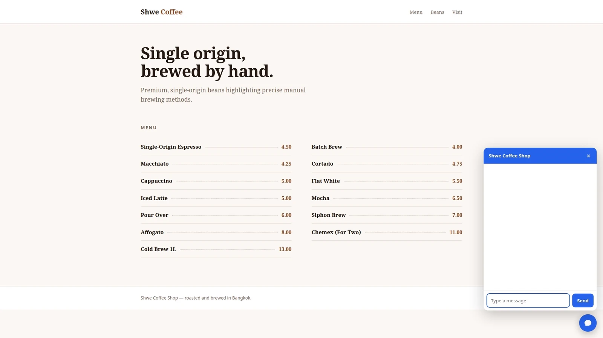
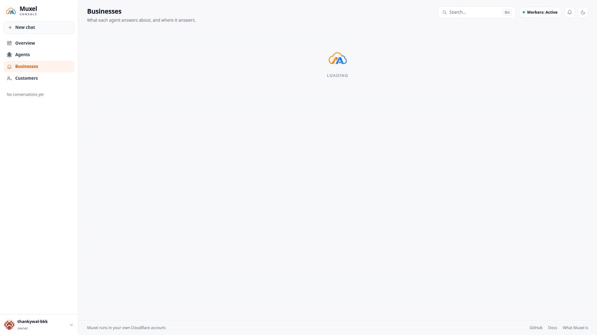
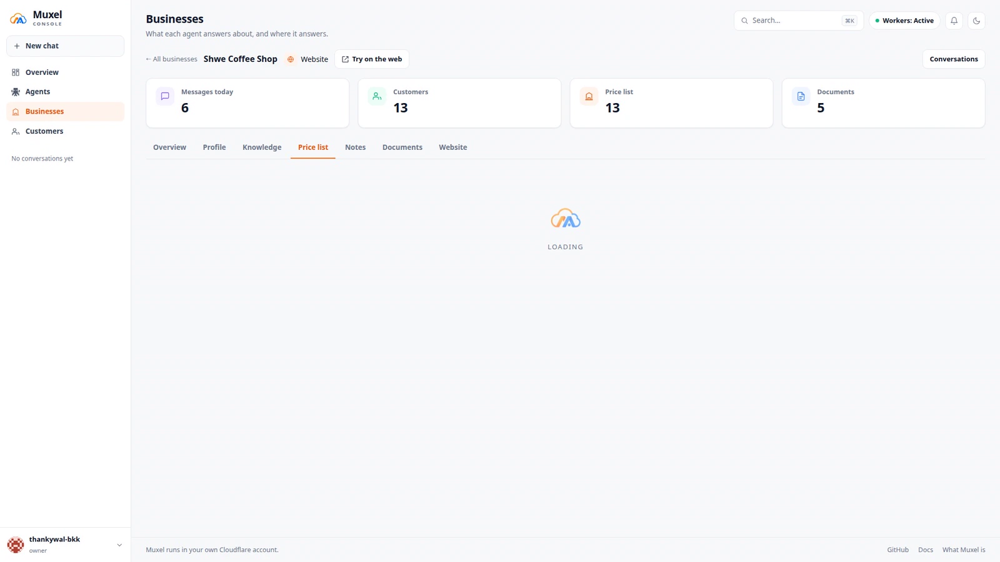
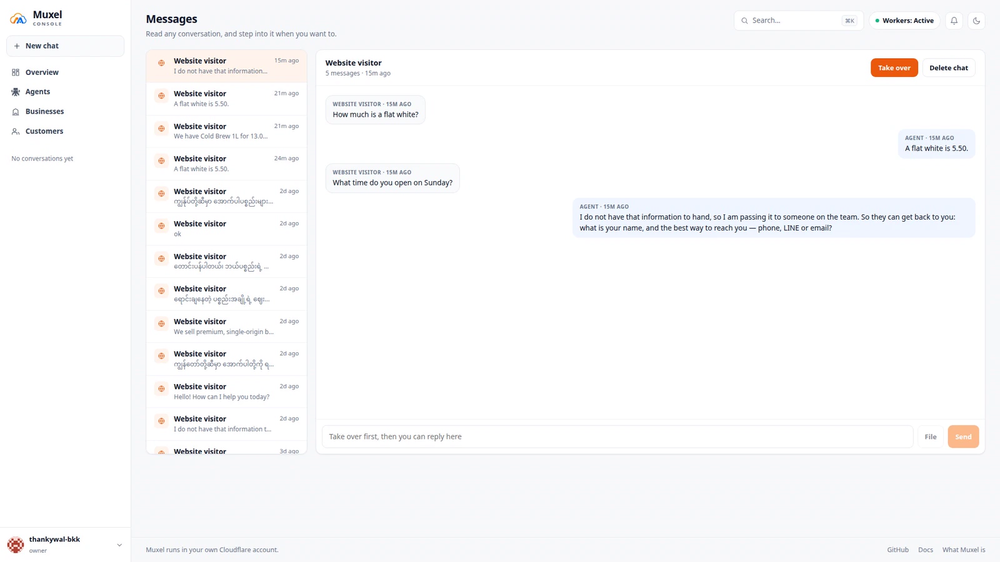

[English](README.md) · **မြန်မာ** · [ไทย](README.th.md) · [日本語](README.ja.md) · [中文](README.zh.md)

# Muxel

Muxel က ဖောက်သည်တွေရဲ့ မေးခွန်းတွေကို သင့်ဝက်ဘ်ဆိုက်နဲ့ Telegram မှာ ဖြေပေးတဲ့ AI လက်ထောက်ပါ။ သင်တင်ထားတဲ့ ဈေးနှုန်းစာရင်း၊ ကုန်ပစ္စည်းအချက်အလက်နဲ့ ဆိုင်စည်းကမ်းတွေကို အခြေခံပြီး ဖြေပေးပါတယ်။ အဖြေမသိရင် ဆိုင်ဘက်က ဆက်ဖြေပေးနိုင်ဖို့ အကြောင်းကြားပါတယ်။

စနစ်က သင့် Cloudflare အကောင့်ထဲမှာ အလုပ်လုပ်ပါတယ်။ သင့်ဖိုင်တွေနဲ့ စကားပြောမှတ်တမ်းတွေကို အဲဒီအကောင့်ထဲမှာပဲ သိမ်းထားပါတယ်။

**[နမူနာဆိုင်မှာ စမ်းကြည့်ပါ](https://thankywal.github.io/muxel/try/)**။ ကော်ဖီတစ်မျိုးရဲ့ ဈေးနှုန်းကို မေးကြည့်နိုင်ပါတယ်။ အကောင့်ဖွင့်စရာ မလိုပါဘူး။

  

## သုံးတဲ့အခါ ဘယ်လိုပုံစံလဲ

| ဆိုင်ရှင်ကြည့်ရတဲ့ စီမံခန့်ခွဲရာစာမျက်နှာ | AI ဖြေရာမှာ ကိုးကားတဲ့ ဈေးနှုန်းစာရင်း |
| --- | --- |
|  |  |

## ဘာတွေလုပ်လို့ရလဲ

- **ဆိုင်အချက်အလက် ထည့်ပါ။** ဈေးနှုန်းစာရင်းနဲ့ ဆိုင်စည်းကမ်းတွေကို PDF၊ Word၊ Excel၊ CSV၊ TXT၊ Markdown၊ JSON သို့မဟုတ် JSONL ဖိုင်နဲ့ တင်နိုင်ပါတယ်။ **Price list** မှာ ဖိုင်ထဲက ဖတ်ယူထားတဲ့ ကုန်ပစ္စည်းနဲ့ ဈေးနှုန်းတွေကို ကြည့်နိုင်သလို ဈေးပြင်တာ၊ မရောင်းတော့တဲ့ ပစ္စည်းကို စာရင်းကနေ ဖယ်တာတွေလည်း လုပ်နိုင်ပါတယ်။
- **လိုအပ်ရင် ကိုယ်တိုင် ဝင်ဖြေပါ။** လူက ဆက်ဖြေပေးရမယ့် စကားပြောခန်းတွေကို **Waiting for you** မှာ ကြည့်ပါ။ **Take over** နဲ့ ဝင်ဖြေပြီး **Give back to the agent** နဲ့ AI ကို ပြန်လွှဲနိုင်ပါတယ်။
- **ဖောက်သည်မှတ်တမ်း ကြည့်ပါ။** အရင်က ပြောထားတဲ့ အသုံးဝင်တဲ့ အချက်အလက်တွေကို AI က မှတ်ထားပေးပါတယ်။ **Customers** မှာ မှတ်စုထည့်နိုင်သလို မှတ်ထားတဲ့ အချက်အလက်တွေကိုလည်း ဖျက်နိုင်ပါတယ်။
- **AI ဖြေပုံကို သတ်မှတ်ပါ။** **Agents** မှာ သက်ဆိုင်ရာ AI ကို ဖွင့်ပါ။ **Persona** မှာ ဖြေစေချင်တဲ့ပုံစံကို ရေးပြီး **Rules** မှာ လိုက်နာရမယ့် စည်းကမ်းတွေ ထည့်နိုင်ပါတယ်။
- **လုပ်ငန်းတွေကို တစ်နေရာတည်းမှာ စီမံပါ။** လုပ်ငန်းတစ်ခုစီရဲ့ ဖိုင်၊ ဖောက်သည်နဲ့ စကားပြောမှတ်တမ်းတွေကို သီးသန့်ထားပါတယ်။ Web console ထဲက AI ကို မီနူး၊ ဇယားဖိုင် ဒါမှမဟုတ် ဈေးနှုန်းဘုတ်ဓာတ်ပုံ ပေးပြီး ပြင်ဆင်ချက် အကြံပြုခိုင်းနိုင်ပါတယ်။ သင် အတည်ပြုပြီးမှ အဲဒီပြင်ဆင်ချက်ကို သိမ်းပါတယ်။

## မစတင်မီ ပြင်ဆင်ရန်

စတင်တပ်ဆင်ဖို့ အခမဲ့အကောင့် နှစ်ခုနဲ့ ၁၀ မိနစ်လောက် လိုပါတယ်။ ငွေပေးချေဖို့ ကတ်ထည့်စရာ၊ ကုဒ်ရေးစရာ မလိုပါဘူး။ Telegram အကောင့် မရှိလည်း စသုံးလို့ရပါတယ်။

### ၁။ Cloudflare အကောင့်

[Cloudflare မှာ အကောင့်ဖွင့်ပါ](https://dash.cloudflare.com/sign-up)။ အီးမေးလ်ကို အတည်ပြုပြီး Free plan နဲ့ ဆက်သုံးပါ။

### ၂။ GitHub အကောင့်

[GitHub မှာ အကောင့်ဖွင့်ပါ](https://github.com/signup)။ Cloudflare က Muxel ကုဒ်မိတ္တူကို သင့် GitHub အကောင့်ထဲမှာ ထားပြီး အဲဒီကနေ တပ်ဆင်ပေးပါတယ်။

## Cloudflare မှာ တပ်ဆင်နည်း

1. [Deploy to Cloudflare](https://deploy.workers.cloudflare.com/?url=https://github.com/thankywal/muxel) ကို နှိပ်ပါ။ Cloudflare အကောင့်ဝင်ပြီး GitHub ကို ချိတ်ပါ။ တပ်ဆင်နေစဉ် တောင်းလာတဲ့ Cloudflare ရဲ့ GitHub app ကို ထည့်ပါ။
2. တပ်ဆင်ဖို့ ဖြည့်ရတဲ့ စာမျက်နှာမှာ **KV namespace** နဲ့ **D1 database** အတွက် ပြထားတဲ့ နာမည်တွေကို သုံးပါ။ **Vectorize** မှာ **Dimensions** ကို `1024`၊ **Metric** ကို `cosine` ထည့်ပြီး **Create and deploy** နှိပ်ပါ။
3. တပ်ဆင်ပြီးရင် Cloudflare ပြပေးတဲ့ **Worker လိပ်စာ** ကို ဖွင့်ပါ။ အဲဒီစာမျက်နှာမှာ ပြထားတဲ့ **console key** ကို ကူးပြီး သိမ်းထားပါ။ ပထမဆုံး console ထဲ ဝင်ပြီးတာနဲ့ အဲဒီစာမျက်နှာမှာ key ကို ထပ်မပြတော့ပါဘူး။
4. [Muxel console](https://thankywal.github.io/muxel/) ကို ဖွင့်ပြီး Worker လိပ်စာနဲ့ console key ကို ထည့်ပါ။ **Businesses → Create business** ကို နှိပ်ပါ။ ဆိုင်နာမည် ရိုက်ထည့်ပြီး **My website** ကို ရွေးပါ။ ဈေးနှုန်းစာရင်း ဒါမှမဟုတ် ဆိုင်စည်းကမ်းဖိုင်ကို အဲဒီမှာ တင်နိုင်ပါတယ်။ နောက်မှ ထပ်တင်ချင်ရင် **Documents → Upload** ကို သုံးပါ။ ဖိုင်တင်ပြီး တစ်မိနစ်လောက် စောင့်ပြီးမှ စမ်းမေးကြည့်ပါ။

Worker လိပ်စာမှာ `Hello world` ပဲ ပေါ်နေရင် [တပ်ဆင်မှု ပြဿနာဖြေရှင်းနည်း](docs/DEPLOY-RECOVERY.md) ကို ကြည့်ပါ။ ဒီအဆင့်တွေကို တခြားသူဆီ စာတိုနဲ့ ပို့ပေးချင်ရင် [မြန်မာလို စတင်သုံးနည်း](docs/TELEGRAM-SETUP.md#မြန်မာ) ကို သုံးနိုင်ပါတယ်။

## ကိုယ့်ဝက်ဘ်ဆိုက်မှာ chat ထည့်နည်း

1. Console ထဲမှာ လုပ်ငန်းကို ဖွင့်ပြီး **Try on the web** ကနေ စမ်းမေးကြည့်ပါ။
2. **Website** tab ထဲက **Sites allowed to show it** မှာ ကိုယ့်ဝက်ဘ်ဆိုက်လိပ်စာ ထည့်ပြီး **Save** နှိပ်ပါ။
3. **Put it on your site** အောက်က script တစ်ကြောင်းကို ကူးပြီး chat ပေါ်စေချင်တဲ့ ဝက်ဘ်စာမျက်နှာရဲ့ `</body>` မတိုင်ခင် ထည့်ပါ။

## Telegram နဲ့ သုံးချင်ရင်

- **ဖောက်သည်အတွက် bot**။ Telegram မှာ [@BotFather](https://t.me/BotFather) ကို `/newbot` ပို့ပြီး bot ဖန်တီးပါ။ ရလာတဲ့ token ကို console ထဲမှာ သက်ဆိုင်ရာလုပ်ငန်းရဲ့ **Overview → Telegram** မှာ ထည့်ပြီး **Attach** နှိပ်ပါ။
- **ဆိုင်ရှင်အတွက် console bot**။ BotFather မှာ သီးသန့် bot တစ်ခု ဖန်တီးပါ။ [@userinfobot](https://t.me/userinfobot) ဆီ `/start` ပို့ပြီး ကိုယ့် Telegram ID ကို ယူပါ။ Cloudflare မှာ Worker ရဲ့ **Settings → Variables and Secrets** ကို ဖွင့်ပါ။ Bot token ကို `ADMIN_BOT_TOKEN`၊ Telegram ID ကို `OWNER_TELEGRAM_ID` အဖြစ် ထည့်ပါ။ Worker လိပ်စာကို တစ်ခါဖွင့်ပြီး bot အသစ်ဆီ `/start` ပို့ပါ။

## Console key ပျောက်သွားရင်

Cloudflare မှာ Worker ရဲ့ **Settings → Variables and Secrets** ကို သွားပါ။ အနည်းဆုံး စာလုံး ၁၆ လုံးပါတဲ့ key အသစ်ကို `CONSOLE_KEY` အမည်နဲ့ secret အဖြစ် ထည့်ပါ။ Key အသစ်နဲ့ ပြန်ဝင်နိုင်ပါတယ်။ Key အဟောင်းနဲ့ ဝင်ထားတာတွေ အလိုအလျောက် ထွက်သွားပါမယ်။

## ကုန်ကျစရိတ်နဲ့ အပ်ဒိတ်

- **ကုန်ကျစရိတ်။** Muxel သုံးခ မရှိပါဘူး။ ကုန်ကျစရိတ်က Cloudflare မှာ သုံးတဲ့ ပမာဏနဲ့ ရွေးထားတဲ့ AI model ပေါ် မူတည်ပါတယ်။ သုံးစွဲမှုကို console ရဲ့ **Settings → General → Usage today** မှာ ကြည့်နိုင်ပါတယ်။ [အသေးစိတ် တွက်ချက်ပုံ](README.md#running-costs)
- **အပ်ဒိတ်။** ဗားရှင်းအသစ် ရှိရင် console ရဲ့ **Settings → Deployment** မှာ ကြည့်နိုင်ပါတယ်။ [အပ်ဒိတ်လုပ်နည်း](README.md#staying-up-to-date)

## အသေးစိတ်ဖတ်ရန်

- [Terminal ကနေ တပ်ဆင်နည်း](README.md#deploy-from-a-terminal)
- [AI model ရွေးနည်း](README.md#choosing-a-model)
- [လုံခြုံရေးဆိုင်ရာ အချက်အလက်](README.md#security) · [ပြဿနာတင်ပြရန်](SECURITY.md)
- [Developer လမ်းညွှန်](README.md#development) · [Apache 2.0 လိုင်စင်](LICENSE)
